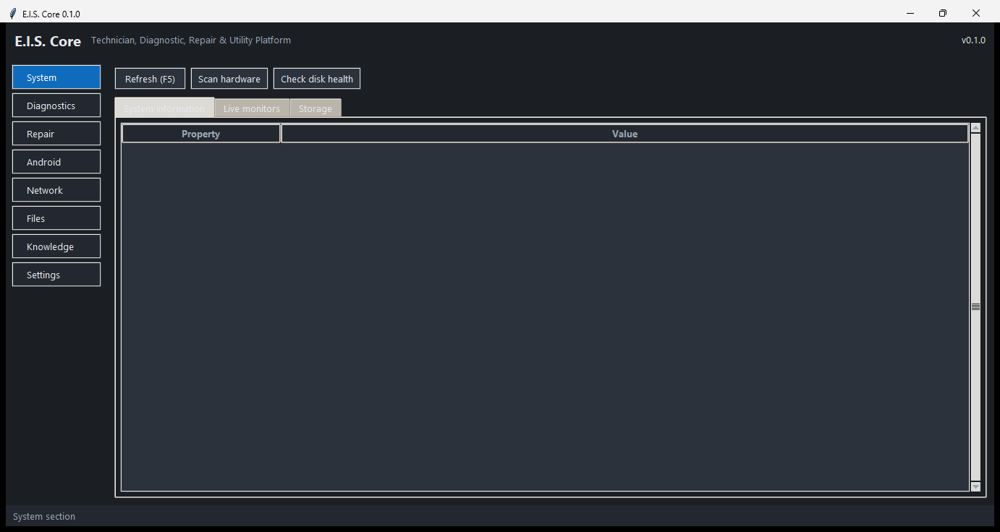

# E.I.S. Core — Electronic Intelligence & Service Core

**A lightweight, community-focused technician, diagnostic, repair and utility platform for Windows.**

E.I.S. Core gives PC technicians, repair shops and power users one professional dashboard for
hardware inspection, Windows repair, Android servicing, network diagnostics, file forensics and a
searchable troubleshooting knowledge base — built entirely on the Python standard library with a
local SQLite database. No telemetry, no cloud, no accounts.



---

## Highlights

- **One dashboard, eight sections** — System, Diagnostics, Repair, Android, Network, Files,
  Knowledge and Settings, with a dark/light theme engine.
- **Zero mandatory dependencies** — Python + Tkinter + SQLite is all you need. The optional
  `psutil` package simply adds richer CPU/RAM detail when present.
- **Safety engine built in** — destructive commands are classified, confirmed and (where
  irreversibly dangerous) blocked outright; protected system directories are refused by cleaners
  and the duplicate finder.
- **Local-first data** — customers, devices, jobs, notes and command history live in a single
  SQLite file you own; every action is logged with timestamps and results.
- **Offline-friendly** — every tool degrades gracefully without internet, Android devices or
  administrator rights.

## Requirements

| Component | Minimum |
|---|---|
| OS | Windows 10 / 11 (64-bit) |
| Python | 3.10 or newer (3.13 recommended) — [python.org](https://www.python.org/downloads/) with *tcl/tk* included |
| Disk | ~30 MB plus data |
| Optional | `psutil` (richer hardware detail), Android *platform-tools* (ADB/Fastboot) |

## Quick start

```bat
:: from the project folder
python __main__.py
```

or double-click **`EIS-Core.bat`** — full walkthrough in the
[User Guide](docs/USER-GUIDE.md); setup details in [docs/INSTALL.md](docs/INSTALL.md).

```bat
:: optional: richer hardware telemetry
pip install psutil

:: run the test suite (development)
python -m pytest tests/ -q
```

## Feature map

### 🔧 System
CPU, RAM, GPU, motherboard, BIOS, storage, OS and uptime viewer · connected-hardware scanner ·
live RAM and CPU monitors (usage, cores/threads, frequency, temperature when exposed) · storage
analyzer (drives, partitions, capacity, free space, filesystem) · SMART / Windows storage health
checker.

### 🩺 Diagnostics
Windows event-log viewer with error/warning/critical filtering · process manager (PID, CPU, RAM,
path, details) · installed applications manager with search and safe uninstall shortcuts · startup
manager · Windows services manager (status, startup type, descriptions) · firewall, Windows
Defender and restore-point status centers (Defender is *never* disabled by E.I.S.).

### 🛠️ Repair
SFC repair center with progress output and logs · DISM health check / scan / repair center · DNS
cache flush · temporary-file cleaner with selectable locations and estimated recoverable space ·
network reset center with explicit confirmation.

### 🤖 Android
ADB & Fastboot auto-detection · device information (model, manufacturer, Android version, serial,
build) · curated safe command presets plus an advanced manual console (safety-gated) · APK
analyzer (package, version, permissions, SDK, metadata) · package manager (list / enable /
disable / uninstall with confirmation) · backup assistant · Logcat viewer with filtering, search,
pause, clear and export.

### 🌐 Network
Adapter viewer (IP, gateway, DNS, MAC) · ping tool with latency, packet loss and history · DNS
lookup and record diagnostics · layered internet connectivity tests (gateway → DNS → external) ·
Wi-Fi information viewer · port tester for selected hosts/ports · non-invasive local network
discovery.

### 📁 Files
Hashing tool (MD5, SHA-1, SHA-256, SHA-512) with verification · hash-based duplicate finder that
refuses protected directories · file metadata inspector · secure password & passphrase generator
(cryptographically secure randomness) · QR payloads for Wi-Fi, URLs, text and technician contact.

### 📚 Knowledge
Searchable troubleshooting knowledge base connecting errors with causes, diagnostics and
solutions · community-extensible with custom entries · helpful/not-helpful feedback.

### 🗄️ Workspace
SQLite technician database for customers, devices, jobs, repair records and notes · command
history with timestamps, results, errors and diagnostic logs · report generator exporting TXT,
JSON and HTML technical reports · settings center for appearance, language, logging, safety,
permissions and tool preferences.

## Safety philosophy

E.I.S. Core is a repair tool — it must never be the reason a system dies. The safety engine
([`eis/core/safety.py`](eis/core/safety.py)) classifies every command as *read*, *state-changing*,
*destructive* or **blocked**; destructive actions require explicit confirmation, and patterns such
as `format`, `diskpart`, `shutdown`, `fastboot flashing unlock` or `adb shell su` are refused
outright. Cleaners and the duplicate finder refuse to operate inside protected directories
(Windows, Program Files, user profile folders, drive roots). Administrator rights are requested
only when a tool genuinely requires them. Details: [docs/SECURITY.md](docs/SECURITY.md).

## Architecture

```
eis/
├── app.py              # application entry (main())
├── core/               # settings, safety engine, command runner, logging, paths, privilege
├── database/           # SQLite connection, migrations, repositories (customers, jobs, history)
├── modules/
│   ├── system/         # system info, hardware, monitors, storage/SMART
│   ├── windows/        # os info, processes, apps, startup, repair, maintenance, events,
│   │                   # services, security
│   ├── network/        # adapters, ping, dns, connectivity, wifi, ports, discovery
│   ├── android/        # adb/fastboot, console, apk, packages, backup, logcat
│   ├── files/          # hashing, duplicates, metadata, generators, wordlist
│   ├── knowledge/      # KB engine + built-in entries
│   └── reports/        # TXT/JSON/HTML report generator
└── ui/                 # Tkinter app shell, theme, widgets + one view per section
```

The UI never blocks: long operations run in worker threads and post results to a queue that the
main loop pumps. See [docs/DEVELOPER.md](docs/DEVELOPER.md) for the threading pattern, module
conventions and how to add a tool.

## Documentation

| Document | Contents |
|---|---|
| [docs/USER-GUIDE.md](docs/USER-GUIDE.md) | **Plain-language guide: install, first run and daily use** |
| [docs/INSTALL.md](docs/INSTALL.md) | Installing Python, optional components, portable setup, first run |
| [docs/DEVELOPER.md](docs/DEVELOPER.md) | Architecture, coding conventions, testing, adding modules/tools |
| [docs/TROUBLESHOOTING.md](docs/TROUBLESHOOTING.md) | Common problems and fixes (ADB, admin rights, SMART, …) |
| [docs/CONTRIBUTING.md](docs/CONTRIBUTING.md) | Reporting issues, PR workflow, code style, release process |
| [docs/SECURITY.md](docs/SECURITY.md) | Safety engine, data handling, vulnerability reporting |

## Project status

E.I.S. Core is at **v0.1.0** — feature-complete for its first release, covered by a 150-test
automated suite (`python -m pytest tests/ -q`), and documented for both users and contributors.
It is developed in the open for the E.I.S. community.

## License

MIT — see [LICENSE](LICENSE). Use it, study it, ship it, improve it.
